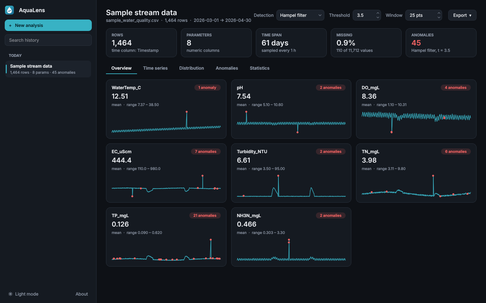
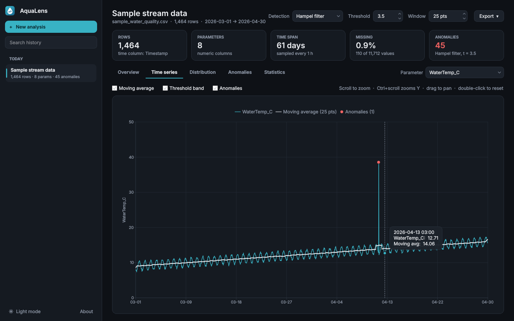
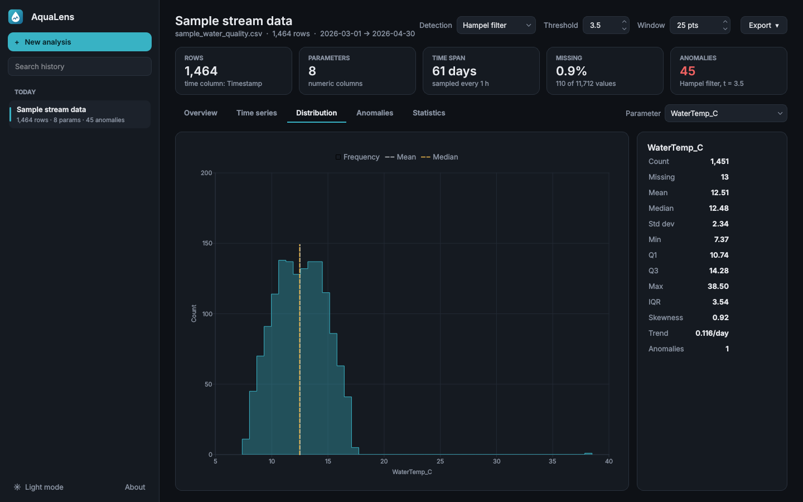
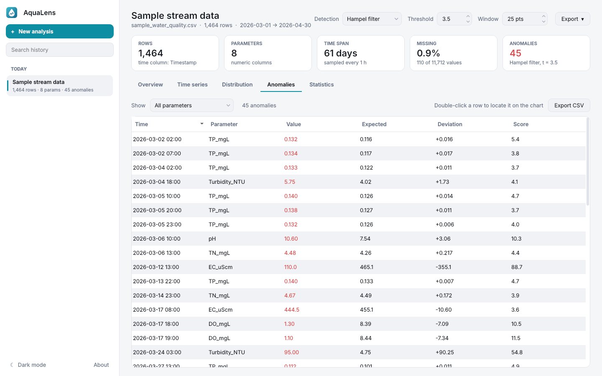

# AquaLens — Water Quality Data Analyzer

A desktop application in **C++17 / Qt 6** for analyzing water quality CSV datasets.
Upload a file, get descriptive statistics, interactive time-series charts and automatic
anomaly detection. Every analysis is saved in a local SQLite history, listed in a
sidebar like chats in ChatGPT or Claude.

## Features

| Area | What it does |
|---|---|
| **CSV import** | Drag & drop or file picker. Long-format files (`Time, Metric, Value, Unit`, e.g. sensor exports) are reshaped into one column per metric. Auto-detects delimiter (`,` `;` tab `\|`), quoted fields, decimal comma, UTF-8/BOM or system code page (e.g. Korean CP949), 30 date/time formats, separate *Date* + *Time* columns, missing-value tokens (`NA`, `null`, `-`, …). Rows are sorted by time. |
| **Overview** | One card per parameter: mean, range, anomaly badge and sparkline. Click a card to open its chart. |
| **Time series** | Raw signal, moving average, threshold band, anomaly markers. Mouse-wheel zoom, Ctrl+wheel for the Y axis, drag to pan, double-click to reset, hover tooltip with exact values. Large series are decimated (min/max per bucket) so spikes stay visible. |
| **Distribution** | Histogram (Freedman–Diaconis bins) with mean, median and threshold lines, plus a statistics panel. |
| **Anomalies** | Sortable table of flagged points with expected value, deviation and score; filter by parameter; double-click jumps to the point on the chart. |
| **Korean WQI** | Water quality grades (Ia–VI, 매우 좋음 … 매우 나쁨) from the Korean living-environment standards (생활환경기준, NIER) for rivers or lakes. Columns are matched automatically (pH, BOD, COD, TOC, SS, DO, T-P, T-N, Chl-a, coliforms; English or Korean names). One card per parameter: grade badge, grade-range scale with the data as a box plot, share of samples per grade and grade III compliance. Overall grade = most limiting parameter. Export as CSV. |
| **Statistics** | Count, missing, mean, median, std, min, Q1, Q3, max, skewness, linear trend per day, anomaly count. |
| **History** | Sessions grouped by *Today / Yesterday / Previous 7 days …*, search, rename, pin, delete. The raw CSV is stored with each session, so it reopens even if the original file is gone. Changing detection settings updates the saved session. |
| **Export** | Chart as PNG (2× resolution), statistics CSV, anomalies CSV. |
| **UI** | Dark and light themes, responsive card grid, background processing (the UI never freezes). |

### Anomaly detection methods

| Method | Rule | Best for |
|---|---|---|
| **Hampel filter** (default, t = 3.5) | \|x − rolling median\| > t · 1.4826 · rolling MAD | Sensor spikes in data with daily cycles or trends |
| **Z-score** (t = 3.0) | \|x − mean\| > t · σ | Roughly normal, stationary data |
| **IQR fences** (k = 1.5) | x < Q1 − k·IQR or x > Q3 + k·IQR | Skewed data, robust global outliers |

The window (default 25 points) controls both the Hampel filter and the moving average.

### Korean Water Quality Index

Source: NIER, 수질 및 수생태계 환경기준 — 생활환경기준
(https://water.nier.go.kr/web/contents/contentView/?pMENU_NO=37). Limits in mg/L unless noted.

| River (하천) | Ia | Ib | II | III | IV | V | VI |
|---|---|---|---|---|---|---|---|
| pH | 6.5–8.5 | 6.5–8.5 | 6.5–8.5 | 6.5–8.5 | 6.0–8.5 | 6.0–8.5 | – |
| BOD ≤ | 1 | 2 | 3 | 5 | 8 | 10 | > 10 |
| COD ≤ (reference) | 2 | 4 | 5 | 7 | 9 | 11 | > 11 |
| TOC ≤ | 2 | 3 | 4 | 5 | 6 | 8 | > 8 |
| SS ≤ | 25 | 25 | 25 | 25 | 100 | no debris | – |
| DO ≥ | 7.5 | 5.0 | 5.0 | 5.0 | 2.0 | 2.0 | < 2.0 |
| T-P ≤ | 0.02 | 0.04 | 0.1 | 0.2 | 0.3 | 0.5 | > 0.5 |
| Total / fecal coliform ≤ (CFU/100 mL) | 50 / 10 | 500 / 100 | 1,000 / 200 | 5,000 / 1,000 | – | – | – |

Lakes (호소) use their own limits for COD, TOC, SS, T-P and add T-N and Chl-a (mg/m³);
T-P is not applied when TN/TP < 7 and T-N is not applied when TN/TP ≥ 16.

**Method:** every sample is graded; a parameter's grade is the grade of its mean (or median);
the overall grade is the grade of the most limiting parameter. COD is shown for reference only
(its standard applied until 2015-12-31 and TOC replaced it).

## Build on Windows (Visual Studio)

**Requirements**
1. Visual Studio 2022 or 2026 with the workload **Desktop development with C++**
   (includes *C++ CMake tools for Windows*).
2. Qt 6.4 or newer from the [Qt Online Installer](https://www.qt.io/download-qt-installer):
   select **MSVC 2022 64-bit** and, under *Additional Libraries*, **Qt Charts**.

**Steps**
1. Double-click `generate_vs_solution.bat`. It finds Qt under `C:\Qt`, generates
   `build\AquaLens.sln` and opens it. (If Qt is elsewhere: `set QTDIR=D:\Qt\6.8.3\msvc2022_64` first.)
2. In Visual Studio press **F5**. After each build, `windeployqt` copies the Qt DLLs and
   the SQLite driver next to `AquaLens.exe`, so the exe also runs by double-click.

Alternative: *File → Open → Folder…* in Visual Studio opens `CMakeLists.txt` directly
(set `CMAKE_PREFIX_PATH` to your Qt folder in CMake settings).

**Manual command line**
```
cmake -S . -B build -G "Visual Studio 17 2022" -A x64 -DCMAKE_PREFIX_PATH=C:/Qt/6.8.3/msvc2022_64
cmake --build build --config Release
```

## Usage

1. Click **Browse files**, drop a CSV on the window, or try **Try sample dataset**
   (`samples/sample_water_quality.csv`: 61 days of hourly stream data with injected sensor faults).
2. Explore the tabs; change **Detection / Threshold / Window** to re-run the analysis.
3. Previous analyses are in the left sidebar. Right-click an entry to rename, pin or delete it.

**CSV format:** first row = column names; one optional date/time column; numeric parameter
columns; text columns (e.g. station name) are ignored and reported.

```
Timestamp,WaterTemp_C,pH,DO_mgL,EC_uScm,Turbidity_NTU
2026-03-01 00:00,8.06,7.35,8.62,457.8,3.58
2026-03-01 01:00,7.85,7.31,8.54,459.8,
```

## Project structure

```
AquaLens/
├── CMakeLists.txt              build definition (Qt6 Widgets, Charts, Sql, Concurrent)
├── generate_vs_solution.bat    creates build/AquaLens.sln
├── resources/                  sample dataset + icons, compiled into the exe (resources.qrc)
├── samples/                    sample CSV for testing upload
└── src/
    ├── main.cpp
    ├── core/                   logic, no GUI code
    │   ├── CsvParser.*         CSV → Dataset (detection of delimiter, encoding, time column)
    │   ├── Analyzer.*          statistics, trend, moving average, anomaly detection
    │   ├── KoreanWqi.*         Korean water quality grades (생활환경기준)
    │   └── Database.*          SQLite history (sessions + compressed CSV blobs)
    └── ui/                     presentation layer
        ├── MainWindow.*        layout, background jobs, rendering of all tabs
        ├── InteractiveChartView.*  zoom / pan / hover on top of QChartView
        ├── Widgets.*           DropZone, CardGrid, ParamCard, SessionDelegate
        ├── WqiWidgets.*        grade scale, grade share bar, WQI cards, grade legend
        └── Theme.*             dark/light palettes and the application stylesheet
```

**Data flow:** file → `CsvParser::parse` → `Dataset` → `Analyzer::run` → `AnalysisResult`
→ `MainWindow` renders charts and tables → `Database` stores the session.
Parsing and analysis run on a worker thread (`QtConcurrent::run` + `QFutureWatcher`).

### Database schema

```sql
sessions(id INTEGER PK, title, file_name, created_at, updated_at, pinned,
         row_count, param_count, anomaly_count, settings JSON, summary JSON)
session_data(session_id INTEGER PK → sessions.id ON DELETE CASCADE, csv BLOB /* zlib */)
```

Location: `%APPDATA%\AquaLens\AquaLens\history.db` (shown in *About*).
Delete the file to clear all history.

## Screenshots





